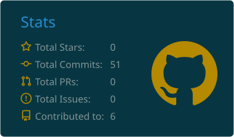
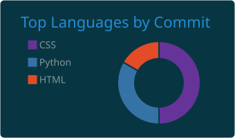

 

### `01. ABOUT ME`

Olá! Sou **Adryel Morais**, estudante de Análise e Desenvolvimento de Sistemas e Engenharia de Software.
Tenho interesse em desenvolvimento backend, arquitetura de software e criação de soluções tecnológicas.

> Hello! I'm Adryel Morais, a Software Development student interested in backend development, software engineering and building practical solutions.

### `02. TECH STACK`

### `03. CURRENTLY LEARNING`

### `04. PROJECTS`

 

### `05. GITHUB ANALYTICS`

 

 
  <picture>
  <source media="(prefers-color-scheme: dark)" srcset="https://raw.githubusercontent.com/dRx1Code/dRx1Code/output/github-snake-dark.svg"/>
  
</picture>

### `06. CONNECT`

  

